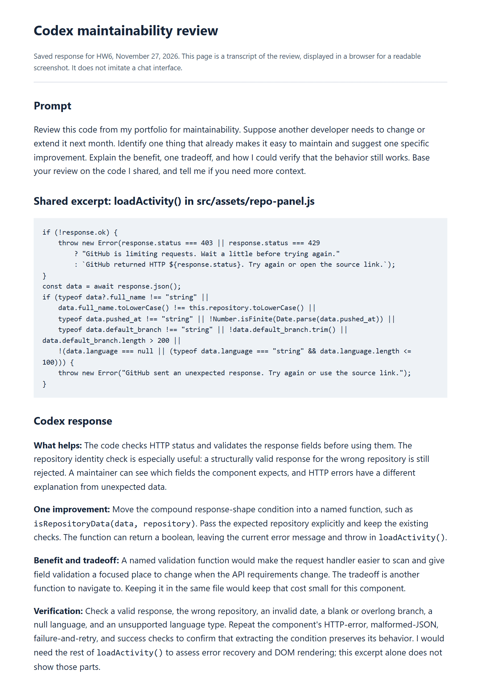

# Benedict's portfolio · CSE 134B HW6

This is my HW5 portfolio moved into the Eleventy project from the HW5 exercise. The site keeps the original navy and gold styles, light and dark themes, profile pictures, and coursework. The projects now come from one JSON file. An API component on the portfolio project's page lets someone reviewing the site check the earlier repository's activity and open its source.

## Build and preview

Tested with **Node.js 24.11.0** and **npm 11.6.1** on Windows. Eleventy is pinned to 3.1.8, and `package-lock.json` records the dependencies.

From the repository root:

```sh
npm ci
npm run build
npm run preview
```

Open <http://127.0.0.1:8081/>. The preview serves **`dist/`**, the finished build, rather than the source files. Stop it with Ctrl+C. `npm run dev` is a separate Eleventy development server on port 8080 that rebuilds while editing.

All nine pages are built together. No browser framework or server runtime is needed on the host. The main HTML, styles, images, navigation, and collection links are in `dist/`. Only the optional live repository check needs GitHub's API.

For checks:

```sh
npm test
npm run verify:clean
```

Browser tests use an installed Google Chrome through Playwright. Chrome is only needed for tests and the review screenshot; installation, building, and previewing do not need Chrome. `verify:clean` copies the source to a temporary folder, installs from the lockfile, builds it, and serves and requests the generated pages. It does not reuse this folder's `node_modules` or `dist`.

## Pages and deployment

<!-- deployment:start -->
- [HW6 repository](https://github.com/bluis1/cse134B-hw6) — public; source files still need to be committed and pushed.

The public deployment has not been created yet. Run the links command below after deploying; it replaces this block with all the actual submission and page links.
<!-- deployment:end -->

| Page | Route |
| --- | --- |
| Home | `/` |
| About | `/about/` |
| Projects index | `/projects/` |
| Skills | `/experience/` |
| Interests | `/interests/` |
| Contact | `/contact/` |
| Portfolio project and Web Component | `/projects/personal-portfolio/` |
| Nachos project | `/projects/nachos-threads/` |
| Third entry: sound design | `/projects/horror-sound-design/` |

Create a new, publicly readable **HW6** repository and push these source files, configuration, lockfile, README, tests, and `docs/` images there. Do not reuse the HW5 remote. `node_modules/` and `dist/` are ignored.

On Netlify, import the new repository. The included `netlify.toml` sets:

- Build command: `npm run build`
- Publish directory: `dist`
- Node version: `24`

For a manual deployment, run the build and upload `dist/` to a new static site. Keep the public site and repository available through grading. Do not replace the HW5 deployment. Another static host can serve the same folder. For hosting below a subdirectory, build with `npm run build -- --pathprefix=/your-folder/`; internal links and asset paths use Eleventy's `url` filter. No current hosting domain is embedded in the templates.

Once the real repository and deployment exist, substitute their URLs here:

```sh
npm run links -- https://github.com/YOUR-USERNAME/YOUR-HW6-REPO https://YOUR-HW6-SITE/
```

This creates **`links.txt`** with exactly four plain HTTPS URLs, in order: repository, homepage, collection index, component page. It also fills in the deployment links above. `links.txt` is intentionally not filled with guessed URLs. Open all four while signed out, commit the updated README and links, and upload `links.txt` to Gradescope. Do not upload a ZIP in its place.

## Rebuild checks for Parts 1 and 2

`src/_includes/base.njk` defines the shared head, navigation, theme script, and main landmark. It includes `src/_includes/footer.njk`. Home and About were migrated from the HW5 Eleventy exercise; Projects, Skills, Interests, and Contact were brought into the same generator. The old standalone exercise, cheese styling, unrelated fact panel, disconnected form demos, and unused sample media are not part of this project.

For the shared-section check, change the footer's “Computer science coursework and creative projects.” text, rebuild, and check Home, About, Projects, Skills, Interests, Contact, and the three detail pages in the deployment links above. All nine use that footer. Restore the text and rebuild afterward. `tests/build.test.mjs` also performs this edit in a temporary copy and checks every output page.

The collection source is **`src/_data/projects.json`**. `src/projects.njk` renders the index, and **`src/project.njk`** uses Eleventy pagination to generate one detail page per entry. Both read the same title and summary data; no separately maintained detail-page HTML is needed.

The reproducible addition check in `tests/build.test.mjs` first builds just the portfolio and Nachos entries. It confirms that the third page does not exist. It then adds the sound-design entry through JSON alone, rebuilds, and verifies both its index link and its detail page. The final source includes all three entries. The test also changes a title in the data and verifies both views, including assets under a non-root path prefix.

To repeat by hand, make a temporary copy, keep the first two JSON entries, and build. Add the third entry back without editing a template, rebuild, and visit `/projects/` and `/projects/horror-sound-design/` directly. With JavaScript disabled, follow all three collection links. The deployed collection and third-entry links are listed above once the actual host is known.

## Portfolio Walkthrough

### 1. Audience, visitor task, and how the site works

The site is for someone looking at my work, such as a recruiter or another student. One task is to find a project, understand what I worked on, and inspect the source if it is public.

Starting at the homepage, use **See my projects**, then **Personal Portfolio Website**. On that detail page, **Check GitHub activity** requests the earlier portfolio repository's latest push date. **Hide repository details** changes how much information is shown and remembers the setting. The GitHub source link opens the earlier code. Contact is available from every page and includes `bluis@ucsd.edu`.

I placed the component beside the portfolio write-up because that is where the source link is useful. It describes the HW5 repository explicitly, so its date is not presented as the deployment date of HW6. The unrelated study-break facts from HW5 were removed.

The shared layout is `src/_includes/base.njk`, with the footer in `src/_includes/footer.njk`. Page content lives in `src/*.njk`; the project entries live in `src/_data/projects.json`. `src/project.njk` is the detail-page template. The component is `src/assets/repo-panel.js`, its surrounding-page control is `src/assets/repo-controls.js`, and its themed styles are in `src/assets/repo-panel.css`.

At build time, Eleventy writes the full HTML pages and copies assets into `dist/`. In the browser, `theme.js` restores the theme and handles the theme button. The registered `<repo-panel>` builds its controls, and the external control restores the display preference from `localStorage`. Clicking the request button fetches GitHub JSON and updates the existing page. The network is needed for the current activity result, not for reading the project or browsing the site.

### 2. Success, failure, retry, and no JavaScript

**Verification status:** These observations are from the local finished build in Chrome. The public HW6 site does not exist yet, so deployed observations remain to be recorded using `TESTING.md`. The automated live request succeeded against the real public GitHub API; separate intercepted requests exercise failure cases.

On success, the component shows **Latest push**, a UTC date, the default branch, the main language, and the time of the check. On the real local check, GitHub returned the repository `bluis1/cse134B-hw5`, a push timestamp of `2026-11-20T04:17:57Z`, branch `main`, and language `HTML`.

After an initial success, blocking the next request leaves that result visible. The status says **Could not reach GitHub. Check your connection and try again.** It also says the last result has not been refreshed, and the button becomes **Try GitHub again**. Removing the block and activating that button loads the result without a page reload. While loading, only the request button is disabled; the surrounding display control and navigation remain usable.

`loadActivity()` in `src/assets/repo-panel.js` checks `response.ok`, parses JSON, validates the fields, and writes API values using `textContent`. Its `catch` handles network, HTTP, malformed JSON, invalid fields, and timeout errors. Its `finally` clears the timer and restores the request button. `setStatus()` updates a persistent polite live region.

Without JavaScript, the generated project description, three project pages, index, navigation, and contact links remain readable. The literal markup in `src/project.njk` supplies the GitHub link and an explanation that live activity needs JavaScript. Both enhancement-only buttons stay hidden. The no-JavaScript test follows ordinary links from Home through the index to the third detail page and directly opens the component page.

Evidence: [real API result](docs/screenshots/component-live.png), [blocked request after success](docs/screenshots/component-error.png), and [JavaScript disabled](docs/screenshots/no-javascript.png). The error screenshot uses a test-intercepted failed request; it is not evidence of a GitHub outage.

### 3. Chosen option: why fetch does not catch a 404 by itself

`fetch()` can resolve to a response even when the HTTP status is 404. That means the server answered; it does not mean the request returned usable data. In `src/assets/repo-panel.js`, `loadActivity()` explicitly checks `if (!response.ok)` and throws before reading successful response data. A 404 therefore reaches `catch`, which shows **GitHub returned HTTP 404. Try again or open the source link.** The current result stays on screen with a warning that it was not refreshed. The browser test intercepts a 404 response and verifies that message and the enabled retry button.

### 4. Chosen scenario A: the API is frequently unavailable

I would keep the project write-up and source link as the main content, then offer a clearly dated saved activity result. The current component already retains its last result after a failed request during the same visit. A useful next step would be retaining a validated result across visits, with a visible **Saved result, checked …** label so it is not mistaken for a new response.

I would change `src/assets/repo-panel.js` to save only the displayed repository fields, repository name, and a `checkedAt` timestamp after a successful validation. On connection, it could read a repository-specific cache key, validate the saved object, and show a result checked within the last 24 hours while still offering a fresh request. Failed requests would keep that result with the saved label. Older, malformed, or mismatched entries would be discarded, leaving the static source link. Storage reads and writes would be guarded like the existing preference code. `src/assets/repo-panel.css` would style the saved label using the site's theme colors.

The benefit is a more useful page during outages; the tradeoff is more state and the possibility of old information. The timestamp and age limit make that limitation visible. I would test fresh and expired caches, the wrong repository, malformed JSON, blocked storage, a failed request followed by success, and both themes. None of this caching proposal is claimed as implemented.

### 5. Maintainability review and evaluation

For the AI review, I shared the HTTP-status and response-validation excerpt from `RepoPanel.loadActivity()` in `src/assets/repo-panel.js`, using the exact prompt in the assignment. This excerpt comes from the Web Component itself. The full prompt, excerpt, and response are preserved in [docs/ai-review.html](docs/ai-review.html). The image below is a browser screenshot of that saved Codex response, rather than a screenshot of a chat interface.



The AI identified checking HTTP status and validating response fields before use as a useful maintenance choice. That matches `loadActivity()`: `response.ok` is checked before reading successful data, and the next condition checks the repository identity, push date, default branch, and language. It recommended extracting that compound condition into `isRepositoryData(data, repository)` while keeping the error handling in the request method.

I would adopt that suggestion when changing the API fields, keeping the helper in `src/assets/repo-panel.js`. The current condition is long enough that a name would make the request flow easier to follow. Passing the expected repository as an argument would also keep the validation independent of the element's DOM state. The tradeoff is another function to read, and there is only one caller today. This is a written evaluation; the current implementation still keeps the checks inline.

The AI also said it needed the rest of the method to assess recovery and rendering. The surrounding code supplies that context: `catch` preserves the current result and offers retry, `finally` restores the request control, and the successful result uses `textContent`. Before extracting validation, I would check valid data, the wrong repository, invalid dates, blank and overlong branches, null language, and unsupported field types. Then I would rerun the existing malformed-JSON, HTTP-error, safe-text rendering, loading, and retry browser checks. The visitor's messages and recovery behavior should remain the same.

## Remaining submission work

1. Commit and push the prepared files to the public HW6 repository, then publish the built site; these steps are being handled manually by the owner.
2. Run the links command using the actual URLs, then commit its README update and four-line `links.txt`.
3. Repeat the browser checks on the public host and replace the local-only status in Walkthrough answer 2 with the actual deployed observations. Confirm that the deployed version matches the committed source.
4. Review the walkthrough wording and the AI response screenshot before submitting. If the instructor requires the original chat UI rather than a saved-response screenshot, replace `docs/ai-review.png` with that screenshot.
5. Submit `links.txt` to Gradescope and keep the site and repository public through grading.

The optional SPA extra credit is not included. The pasted assignment recommends practicing that optional JavaScript by hand. The course POST endpoint is not needed for the required portfolio/component work.

## References and requirement coverage

[REQUIREMENTS.md](REQUIREMENTS.md) maps the supplied assignment to files and checks. [TESTING.md](TESTING.md) records the checks and the remaining public-deployment steps. The pasted assignment was available in full; its linked Canvas download could not be opened, and no separate point-by-point HW6 rubric was supplied.

- [Eleventy pagination](https://www.11ty.dev/docs/pagination/) and [URL filter](https://www.11ty.dev/docs/filters/url/)
- [GitHub repository API](https://docs.github.com/en/rest/repos/repos#get-a-repository)
- Interview prompt context supplied by the assignment: [Kong](https://github.com/Kong/konnect-team-interview-frontend-exercise), [Guidebook](https://github.com/Guidebook/code-challenges/blob/master/web-team/front-end-challenges.md#what-were-evaluating), [GreatFrontEnd](https://www.greatfrontend.com/blog/rest-api-interview-questions-for-frontend-devs), [EVA](https://github.com/eva-gg/frontend-developer-recruitment-test#technical-questions), and [Front-end Developer Interview Questions](https://h5bp.org/Front-end-Developer-Interview-Questions/questions/general-questions/).
